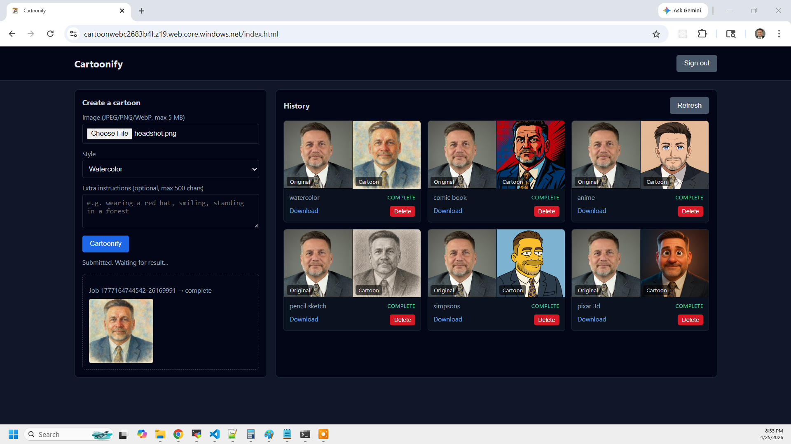

# Photo-to-Cartoon on Azure: Entra External ID, Functions, Service Bus and OpenAI

A serverless **photo-to-cartoon** app. Users sign in with **Microsoft Entra
External ID**, upload a photo straight to **Blob Storage**, and pick one of
six styles. HTTP functions in a **Flex Consumption Function App** queue the
job on **Service Bus**, and a queue-triggered function in the same app sends
the photo to OpenAI's `gpt-image-1` image edit API and stores the cartoon.
Job state lives in **Cosmos DB**. The single-page web app polls for the
result and keeps each user's history.



| Piece | Where | Role |
|---|---|---|
| **cartoonify-app** | Entra External ID tenant | SPA app registration (authorization code with PKCE, v2 tokens), redirect to `callback.html`; `apply.sh` adds it to your sign-up/sign-in user flow |
| **cartoonify-func-&lt;hex&gt;** | `cartoonify-rg`, Central US | Function App on the `FC1` plan, Python, up to 50 instances of 2 GB; five anonymous HTTP functions that validate the bearer token themselves, plus `cartoonify_worker`; system-assigned managed identity; CORS allows only the web origin |
| **sb-cartoonify-&lt;hex&gt;** | Service Bus, Standard | local (key) auth disabled; queue `cartoonify-jobs`: 3 min lock, 10 delivery attempts, 7 day TTL, dead-letters expired messages |
| **cosmos-cartoonify-&lt;hex&gt;** | Cosmos DB | database `cartoonify`, container `jobs` partitioned on `/owner`, 400 RU/s, 7 day default TTL; a custom data role for the app's identity |
| **cartoonmedia&lt;hex&gt;** | Storage | private containers `originals` and `cartoons`, each deleted after 7 days; CORS for browser uploads |
| **cartoonweb&lt;hex&gt;** | Storage | static website with `index.html`, `callback.html`, `config.json` and `favicon.ico` |
| **cartoonfunc&lt;hex&gt;** / **cartoonify-ai-&lt;hex&gt;** | `cartoonify-rg` | deployment package storage, and Application Insights |

## Architecture

<picture>
  <source media="(prefers-color-scheme: dark)" srcset="architecture-dark.svg">
  
</picture>

Regenerate with `python3 make_diagram.py`.

- **`01-backend/`**: the resource group, the Entra app registration
  (`entra.tf`, applied with a service principal in the External tenant),
  Service Bus, Cosmos DB and its data role, and both storage accounts.
- **`02-functions/`**: the Function App, its storage, plan and Application
  Insights, the Service Bus and Cosmos DB role assignments, and all six
  functions in `code/function_app.py`.
- **`03-webapp/`**: `index.html.tmpl` and `callback.html`, uploaded to the
  static website with a generated `config.json`.

The app reaches Service Bus and Cosmos DB with its managed identity. It
signs blob SAS URLs with the media account key, and calls OpenAI with your
API key; both are app settings.

## How a job runs

1. The browser signs in through the user flow (authorization code with PKCE)
   and sends the access token as a bearer token. Each function checks its
   RS256 signature against the tenant's JWKS and that the audience is
   `cartoonify-app`, and uses the `sub` claim as the owner.
2. `POST /api/upload-url` returns a create/write SAS URL for
   `originals/<owner>/<job_id>.<ext>`, valid for 5 minutes, for
   `image/jpeg`, `image/png` or `image/webp`. The browser uploads directly.
3. `POST /api/generate` checks the style, that the blob exists, and that the
   user has made fewer than 10 jobs today (UTC). It writes the job as
   `submitted` and sends it to the queue.
4. The worker marks the job `processing`, downloads the original, crops it
   to a centred square and resizes it to 1024x1024 with Pillow, then calls
   `images.edit` with `gpt-image-1` and the style's prompt plus any
   `prompt_extra`. It saves the PNG to `cartoons/` and marks the job
   `complete`, or `error` with a message if anything fails.
5. The page polls `GET /api/result/{job_id}`, which returns read-only SAS
   links to both images, valid for 4 hours.

## API

Every route needs `Authorization: Bearer <access token>`; jobs are scoped to
the token's user.

| Method | Path | Returns |
|---|---|---|
| POST | `/api/upload-url` | the SAS upload URL, `job_id` and `key`; body `{"content_type": ...}` |
| POST | `/api/generate` | `202` `{"job_id", "status": "submitted"}`; body `{"job_id", "key", "style", "prompt_extra"}`; `429` once the daily quota is used |
| GET | `/api/result/{job_id}` | the job's status, with SAS links once complete |
| GET | `/api/history` | the user's newest 50 jobs |
| DELETE | `/api/history/{job_id}` | deletes both blobs and the job |

Styles: `pixar_3d`, `simpsons`, `anime`, `comic_book`, `watercolor` and
`pencil_sketch`. `prompt_extra` is optional, up to 500 characters.

## Prerequisites

* [An Azure Account](https://portal.azure.com/)
* [Install AZ CLI](https://learn.microsoft.com/en-us/cli/azure/install-azure-cli)
* [Install Terraform](https://developer.hashicorp.com/terraform/install)
* [Install jq](https://jqlang.github.io/jq/download/) and `zip`
* An [OpenAI API key](https://platform.openai.com/api-keys) with access to
  `gpt-image-1`

### One-time Entra External ID setup

Do this in the Azure portal before the first deploy:

1. **Create an External tenant.** Microsoft Entra ID > Overview > Manage
   tenants > New, type **External**. Its subdomain (`myapp` in
   `myapp.onmicrosoft.com`) is `ENTRA_TENANT_NAME`; its tenant ID is
   `ENTRA_TENANT_ID`.
2. **Create a user flow.** In the External tenant, External Identities >
   User flows > New user flow > **Sign up and sign in**, with **Email with
   password**, collecting and returning **Email Address**. Its name is
   `ENTRA_USER_FLOW_NAME`.
3. **Create a service principal in that tenant.** App registrations > New
   registration; add a client secret; add the Microsoft Graph application
   permissions `Application.ReadWrite.All` and `EventListener.ReadWrite.All`
   and grant admin consent. Its client ID and secret are
   `ENTRA_SP_CLIENT_ID` and `ENTRA_SP_CLIENT_SECRET`.

### Environment variables

```bash
# Subscription (a service principal in your main tenant)
export ARM_CLIENT_ID="..."
export ARM_CLIENT_SECRET="..."
export ARM_SUBSCRIPTION_ID="..."
export ARM_TENANT_ID="..."

# Entra External ID
export ENTRA_TENANT_ID="..."
export ENTRA_TENANT_NAME="myapp"
export ENTRA_SP_CLIENT_ID="..."
export ENTRA_SP_CLIENT_SECRET="..."
export ENTRA_USER_FLOW_NAME="..."

# OpenAI (can be added later; re-run apply.sh to set it)
export OPENAI_API_KEY="sk-..."
```

If this is your first time following along, we recommend starting with this
video: [Azure + Terraform: Easy Setup](https://youtu.be/wwi3kVgYNOk).

## Deploy

```bash
git clone https://github.com/mamonaco1973/azure-cartoonify.git
cd azure-cartoonify
./apply.sh
```

`apply.sh`:

1. Applies **`01-backend`**.
2. Gets a Microsoft Graph token as the External tenant's service principal
   and adds `cartoonify-app` to the user flow, retrying while the new app
   propagates.
3. Applies **`02-functions`**, zips `02-functions/code` and deploys it with
   a remote build, retrying if the deployment fails.
4. Writes `config.json` (API URL, client ID, authority) and renders
   `index.html`, then applies **`03-webapp`**.

It ends by running `validate.sh`, which only prints the URLs:

```
=================================================================================
  Deployment validated!
=================================================================================
  API : https://cartoonify-func-<hex>.azurewebsites.net/api
  Web : https://cartoonweb<hex>.z19.web.core.windows.net/index.html
=================================================================================
```

Without `OPENAI_API_KEY`, the deploy succeeds but every job ends in `error`.

## Try it

1. Open the **Web** URL, sign in, and create an account in the user flow
   with your email.
2. Upload a photo, pick a style, and generate. The cartoon appears when the
   job completes and stays in your history for 7 days.

## Teardown

```bash
./destroy.sh
```

## Notes

- **Lab only.** Anyone can sign up through the user flow. Each image is
  billed to your OpenAI account, so the 10-a-day quota is the only cap per
  user.
- The OpenAI key and the media account key are in plain app settings.
- The 5 MB upload limit is checked only in the browser; a SAS URL can't cap
  the size of a blob.
- The token check verifies the signature, audience and expiry, but not the
  issuer.
